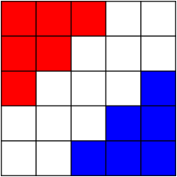

# EWN-AI


An AI engine and GUI for **EinStein würfelt nicht** (EWN), a dice-driven abstract strategy board game. The project combines a classic **Monte Carlo Tree Search (MCTS)** engine with a **deep learning policy network** (trained on real human game records) to guide move selection, and ships with a simple Windows GUI built with EasyX.

## About the Game

EinStein würfelt nicht ("Einstein doesn't play dice") is played on a 5×5 board. Each player controls six numbered pieces (1–6) placed in a triangle in their home corner. On each turn a die is rolled, which constrains which piece may move; players race to either move a piece into the opponent's home corner or capture all of the opponent's pieces.

## Features

- **Three play modes**: Player vs. Player, Player vs. AI, and AI vs. AI
- **Three AI strategies**, selectable at runtime:
  - `MCTS` — Upper Confidence Bound for Trees (UCT) with random rollouts
  - `Random` — a random-move baseline AI
  - `Model` — MCTS/UCT guided by a trained neural network's move probabilities (an AlphaZero-style policy prior)
- **GUI** built with [EasyX](https://easyx.cn/) for board interaction and move visualization
- **Deep learning pipeline** for turning raw human game logs into training data, and training a CNN/ResNet-50 policy model in PyTorch

## Project Structure

```
EWN-AI/
├── EWN/                       # C++ game engine, MCTS AI, and GUI (Visual Studio project)
│   ├── main.cpp                # Entry point / mode selection
│   ├── play.cpp / play.h       # Game-loop orchestration for each play mode
│   ├── game.cpp / game.h       # Board representation (bitboards), rules, win detection
│   ├── gui.cpp / gui.h         # EasyX-based GUI
│   ├── ewnAI.cpp / ewnAI.h     # AI dispatcher (MCTS / Random / Model)
│   ├── mcts.cpp / mcts.h       # Monte Carlo Tree Search driver
│   ├── uct.cpp / uct.h         # UCT selection logic (incl. model-guided variant)
│   ├── tree_node.cpp / .h      # Search tree node representation
│   ├── model.cpp               # LibTorch integration: builds the feature map and queries the policy model
│   ├── randomAi.cpp / .h       # Random-move baseline AI
│   ├── model_ewn.pt            # Trained policy network (TorchScript)
│   └── picture/                # GUI image assets
├── deep learning/
│   ├── data preprocessing.py   # Converts raw human game logs into a training CSV
│   ├── EWN.ipynb               # Feature-map construction, HDF5 conversion, model training/evaluation
│   └── ranking.jpg             # Model evaluation / ranking results
└── EWN/EWN.sln                 # Visual Studio solution
```

## How the AI Works

1. **Board encoding** — Each board state is encoded as a 16×5×5 feature map: one channel per piece (6 red + 6 blue), one for the movable pieces given the current die roll, plus constant and "empty square" channels.
2. **Policy model** — A CNN / ResNet-50 model (trained in `deep learning/EWN.ipynb`) takes the feature map and predicts move probabilities.
3. **Guided search** — In `Model` mode, `uct.cpp` blends the classic UCT exploration/exploitation terms with the policy network's move probability as an additional prior, biasing the tree search toward moves the network favors while still exploring via rollouts.
4. **Training data** — `data preprocessing.py` parses historical human EWN game records (from public game-server match logs) into board states and outcomes, which are used to train the policy network.

## Requirements

- **Windows** + **Visual Studio** (the project is a `.sln`/`.vcxproj` targeting Windows)
- [**EasyX**](https://easyx.cn/) graphics library (for the GUI)
- [**LibTorch**](https://pytorch.org/get-started/locally/) (C++ distribution of PyTorch, for loading `model_ewn.pt` in `model.cpp`)
- **Python 3** with `numpy`, `pandas`, `h5py`/`PyTorch`, and `jupyter` (for the `deep learning/` training pipeline)

## Getting Started

1. Clone the repository and open `EWN/EWN.sln` in Visual Studio.
2. Install EasyX and LibTorch, and configure their include/lib paths in the project settings.
3. Build and run. On launch, choose a game mode (Player vs. Player / Player vs. AI / AI vs. AI) and, if applicable, an AI strategy (MCTS / Random / Model).

### Visual Studio Project Configuration

Assuming LibTorch is extracted to `C:\libtorch`, configure the following in **Project → Properties** (apply to the relevant Configuration/Platform, e.g. `Release | x64`):

| Section | Setting | Value |
|---|---|---|
| Debugging → Environment | — | `PATH=C:\libtorch\lib;%PATH%` |
| General → C++ Language Standard | — | ISO C++20 Standard (`/std:c++20`) |
| C/C++ → General → Additional Include Directories | — | `C:\libtorch\include\torch\csrc\api\include;C:\libtorch\include` |
| Linker → General → Additional Library Directories | — | `C:\libtorch\lib` |
| Linker → Input → Additional Dependencies | — | `C:\libtorch\lib\*.lib;%(AdditionalDependencies)` |

> **Note:** Set the **Debugging → Environment** PATH so the LibTorch `.dll` files (e.g. `torch.dll`, `c10.dll`) can be found at runtime when launching from Visual Studio. If running the built `.exe` outside Visual Studio, either add `C:\libtorch\lib` to your system PATH or copy the required `.dll` files next to the executable.

To retrain the policy network:

1. Place raw game-log text files (per player) alongside `deep learning/data preprocessing.py` and run it to produce `training_data.csv`.
2. Open `deep learning/EWN.ipynb` to convert the CSV into feature maps/HDF5, train the CNN/ResNet-50 model, and export a new `model_ewn.pt`.

## License

No license file is currently included in this repository.