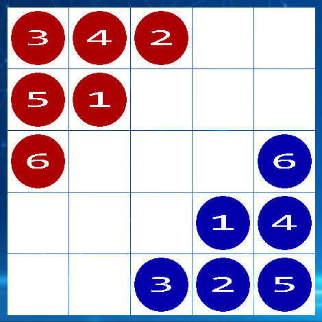

# EWN-AI


An AI engine and GUI for **EinStein würfelt nicht** (EWN), a dice-driven abstract strategy board game. The project combines a classic **Monte Carlo Tree Search (MCTS)** engine with a **deep learning policy network** (trained on real human game records) to guide move selection, and ships with a simple Windows GUI built with EasyX.

## About the Game

EinStein würfelt nicht ("Einstein doesn't play dice") is played on a 5×5 board. Each player controls six numbered pieces (1–6) placed in a triangle in their home corner. On each turn a die is rolled, which constrains which piece may move; players race to either move a piece into the opponent's home corner or capture all of the opponent's pieces.

## Features

- **Three play modes**: Player vs. Player, Player vs. AI, and AI vs. AI (500 games in a row, alternating the side that moves first, with the red side's win rate)
- **Three AI strategies**, selectable at runtime:
  - `MCTS` — Upper Confidence Bound for Trees (UCT) with random rollouts
  - `Random` — a random-move baseline AI
  - `Model` — MCTS/UCT guided by a trained neural network's move probabilities (an AlphaZero-style policy prior)
- **GUI** built with [EasyX](https://easyx.cn/) for board interaction and move visualization
- **Training pipeline** that downloads top players' games from LittleGolem, turns them into training data, and trains a residual policy network in PyTorch, which the game then runs with its own C++ code

## Project Structure

```
EWN-AI/
├── EWN/                        # C++ game engine, MCTS AI, and GUI (Visual Studio project)
│   ├── EWN.sln                 # Visual Studio solution
│   ├── main.cpp                # Entry point / mode selection
│   ├── play.cpp / play.h       # Game-loop orchestration for each play mode
│   ├── game.cpp / game.h       # Board representation (bitboards), rules, win detection
│   ├── gui.cpp / gui.h         # EasyX-based GUI
│   ├── ewnAI.cpp / ewnAI.h     # AI dispatcher (MCTS / Random / Model)
│   ├── mcts.cpp / mcts.h       # Monte Carlo Tree Search driver
│   ├── uct.cpp / uct.h         # UCT selection logic (incl. model-guided variant)
│   ├── tree_node.cpp / .h      # Search tree node representation
│   ├── model.cpp / model.h     # Builds the feature map and runs the policy network
│   ├── randomAi.cpp / .h       # Random-move baseline AI
│   ├── model_ewn.bin           # Trained policy network weights, read by model.cpp
│   ├── model_ewn.json          # How that model was trained: data, settings, test results
│   └── picture/                # GUI image assets loaded at runtime
├── training/                   # Policy network training pipeline (Python)
│   ├── scrape_littlegolem.py   # Downloads the top-rated players' match records from LittleGolem
│   ├── parse_game_logs.py      # Turns the match records into a training CSV
│   ├── data_stats.py           # Prints the statistics of the training data
│   ├── train_policy.ipynb      # Feature maps, HDF5 conversion, policy network training and export
│   ├── requirements.txt        # Python packages for the training pipeline
│   └── game_logs/              # Downloaded match records (generated, not committed)
└── docs/
    └── images/                 # README images
```

## How the AI Works

### Search

`MCTS::AI_move()` in `mcts.cpp` runs a separate search of 100 iterations for every legal move the rolled die allows, one thread per move, and plays the move whose search gives the highest win rate. The search tree holds the moves of every piece, so each step down the tree rolls a die to decide which of them may move, and the side to move picks the child with the best UCT value from its own point of view (`uct.cpp`). Each new node's children are then scored by 100 random games each, which also roll the die every turn, spread over the CPU cores that the threads per move leave idle.

### Board encoding

Each position is encoded as a 16×5×5 feature map, built the same way by `board_to_FM()` in `EWN/model.cpp` and by the training notebook. The game asks the model about one piece at a time, marked in channel 12:

| Channel | Content |
|---|---|
| 0–5 | Red pieces 1–6 |
| 6–11 | Blue pieces 1–6 |
| 12 | The piece to move |
| 13 | All ones, which lets the convolutions find the board edges |
| 14 | How many of the six dice faces let each piece move (a captured piece's faces pass to its nearest remaining neighbors) |
| 15 | How many dice faces let the opponent move a piece onto each square next turn |

### Policy model

For the marked piece, the model outputs a probability for each direction (horizontal, vertical, diagonal). `training/train_policy.ipynb` trains a small residual network (6 residual blocks of 64 channels) and exports its weights to `model_ewn.bin`, with every batch norm folded into the convolution before it. They are stored as float16, half the size of float32 with the same test accuracy. `model.cpp` runs the network on the CPU without any deep learning library, using AVX2 when the CPU has it, and gives illegal directions a probability of 0. The shipped `EWN/model_ewn.bin` was trained this way on the data below: it picks the direction the human player chose for 76.6% of the test moves, against 57.3% for always picking the most common of its legal directions (those that keep it on the board): diagonal whenever all three are legal, see the direction shares below. `EWN/model_ewn.json` records how it was trained.

### Guided search

In `Model` mode, the first time the die lets a piece move from a node, that piece's moves get the policy network's probabilities (`Tree_node::set_children_probs()`, which calls `model_probs()` in `model.cpp`). Most nodes are never selected from, so the network is only asked about the nodes the search goes through. `uct.cpp` adds 10 × probability ÷ visits to the UCT value: a prior that steers the search toward the moves the network favors and fades as the rollouts add up. Its random games also always take a move into the opponent's corner when the die allows one.

### Training data

`scrape_littlegolem.py` downloads the match records of the top 10 players in [LittleGolem](https://www.littlegolem.net/)'s EinStein ranking, and `parse_game_logs.py` turns them into one CSV line per game (initial setups, move list, result), dropping duplicates. Only games decided on the board are kept, where a piece reached the opponent's corner or one side lost all its pieces: the result of a game that a resignation or a time out ended says little about its moves. The notebook then turns each game into board states to train the policy network.

The current training data was downloaded on 2026-11-02 from these players' finished matches:

| Rank | Player | Rating | Matches |
|---:|---|---:|---:|
| 1 | EWN_ghost_ | 2028.7 | 416 |
| 2 | Micco | 2016.0 | 745 |
| 3 | opmp | 1984.9 | 1484 |
| 4 | Fraggle_Reloaded_c | 1968.9 | 1630 |
| 5 | hanfried_c | 1968.8 | 481 |
| 6 | 1Stone | 1965.7 | 220 |
| 7 | bennok | 1958.8 | 588 |
| 8 | Ray Garrison | 1958.7 | 952 |
| 9 | Force majeure | 1949.7 | 427 |
| 10 | Florian Jamain | 1949.2 | 582 |

A match between two listed players counts for both above. Overall, the data has the statistics below, printed by `data_stats.py` (the notebook prints the training / test split):

| | Count |
|---|---:|
| Matches with at least one game decided on the board, each counted once (791 others have none) | 6,807 |
| Games, after removing the 3,745 that appear in two players' logs | 57,714 |
| Moves, i.e. training samples | 966,845 |
| Training / test moves, split by game | 818,470 / 148,375 |
| Moves per game | 16.8 on average, 5 to 32 |

| How the game was won | Games | Share |
|---|---:|---:|
| A piece reached the opponent's home corner | 53,540 | 92.8% |
| All of the opponent's pieces were captured | 4,174 | 7.2% |

| Direction of a move | Moves | Share |
|---|---:|---:|
| Horizontal | 235,334 | 24.3% |
| Vertical | 236,548 | 24.5% |
| Diagonal | 494,963 | 51.2% |

In 6.1% of the moves the piece stands on the far row or column, so only the direction along that edge is legal. When all three directions are legal, players move diagonally 54.5% of the time.

| | Blue | Red |
|---|---:|---:|
| Games won | 28,944 (50.2%) | 28,770 (49.8%) |
| Games started | 32,207 (55.8%) | 25,507 (44.2%) |

The side that moved first won 52.5% of the games, and 40.9% of all moves capture a piece.

## Requirements

- **Windows** + **Visual Studio 2022 or later** with the v143 (MSVC) build tools (the project is a `.sln`/`.vcxproj` targeting Windows)
- [**EasyX**](https://easyx.cn/) graphics library (for the GUI)
- **Python 3** for the `training/` pipeline: the scraper and the data scripts only need Python itself, the notebook needs the packages in `training/requirements.txt`

## Getting Started

1. Clone the repository and open `EWN/EWN.sln` in Visual Studio.
2. Install EasyX.
3. Select the `Release | x64` configuration, then build and run. On launch, choose a game mode (Player vs. Player / Player vs. AI / AI vs. AI) and, if applicable, an AI strategy (MCTS / Random / Model).

Menu options light up under the mouse, and one click picks one. On your turn, the pieces the die lets you move have a yellow ring: click one, then click the square to move it to, which lights up under the mouse. Clicking the chosen piece again lets you choose the other one.

The build also copies `picture/` and `model_ewn.bin` into `EWN/x64/Release/`, so `EWN.exe` there runs on its own, e.g. by double-clicking it. Those three take about 1.1 MB, most of it the model; `EWN.pdb` beside them only holds debugging information.

### Visual Studio Project Configuration

`EWN.vcxproj` already has these settings for both `Release | x64` and `Debug | x64`:

| Setting | Value |
|---|---|
| General → C++ Language Standard | ISO C++20 Standard (`/std:c++20`) |
| Build Events → Post-Build Event | Copies `picture/` and `model_ewn.bin` next to `EWN.exe` |

> **Note:** The game loads `picture/gui_background.jpg` and `model_ewn.bin` relative to the working directory. Visual Studio starts it in the `EWN/` project folder, and the build output folder has copies of both, so it runs from either.

## Training the Policy Network

1. Install the notebook's Python packages: `pip install -r training/requirements.txt`. The scraper and the data scripts need nothing beyond Python itself.
2. Run `python training/scrape_littlegolem.py` to download the current top 10 players' finished standard-rule matches into `training/game_logs/`. By default it sends at most one request per second, so this takes a while; `--workers 4 --delay 0.25` keeps four downloads going at once and is about four times faster. Downloaded matches are cached, so it can be stopped and run again.
3. Run `python training/parse_game_logs.py` to turn the logs in `training/game_logs/` into `training/training_data.csv`, and `python training/data_stats.py` to print its statistics.
4. Open `training/train_policy.ipynb` to convert the CSV into feature maps/HDF5, train the model, and export a new `model_ewn.bin` with its `model_ewn.json`. The notebook reads and writes these files in `DATA_DIR` (set in its first cell): `/content/drive/MyDrive/EWN-AI` on Colab, otherwise the notebook's own folder, so on Colab first upload `training/training_data.csv` to that Google Drive folder. On a Colab T4 GPU, building the HDF5 file takes about 7 minutes and training about 4; later runs reuse the HDF5 file until the CSV changes. The notebook also prints baseline accuracies to judge the model's accuracy by.
5. Copy the exported `model_ewn.bin` and `model_ewn.json` into `EWN/`, where the game loads the model; the next build copies the model to `EWN/x64/Release/` too.

> **Note:** `model.cpp` runs the notebook's `PolicyNet` layer by layer. It reads the numbers of channels and residual blocks from `model_ewn.bin`, but a change to the layers themselves needs the same change in `model.cpp`. On Colab, use the preinstalled PyTorch: another one's CUDA libraries clash with Colab's own and cuDNN fails.
